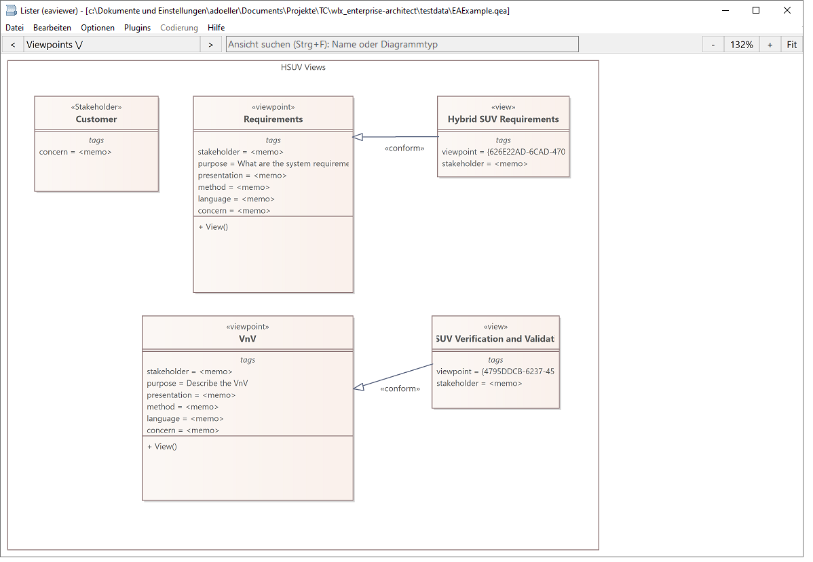
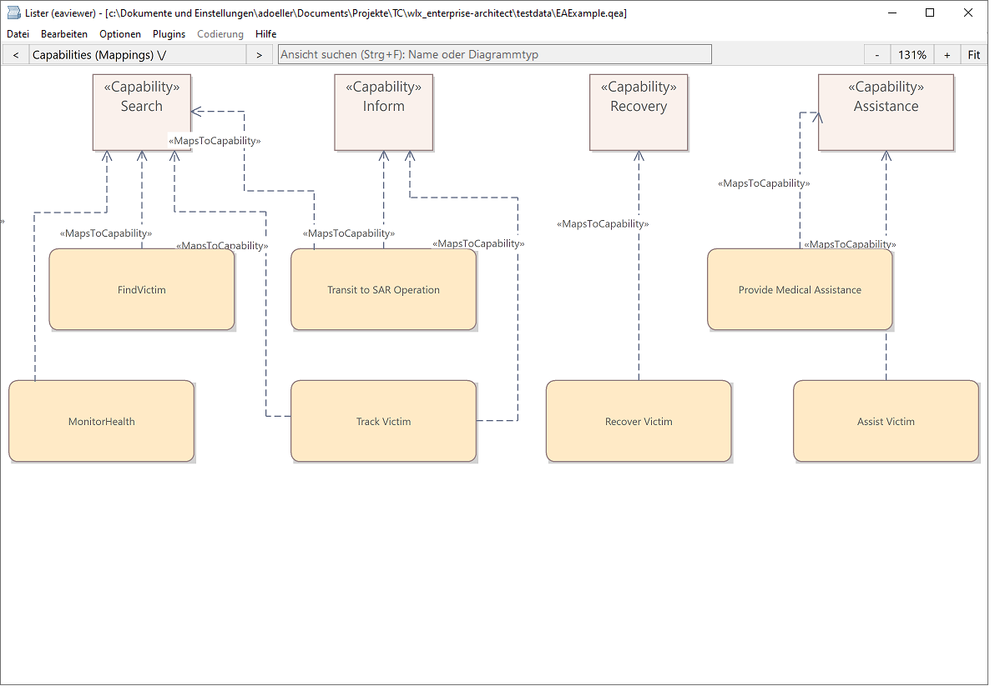

# wlx_enterprise-architect




Total Commander Lister plugin (WLX) for viewing UML diagrams stored in
Sparx Enterprise Architect's SQLite-based project files (`.qea` / `.qeax`).
Open diagrams in the **F3 Lister window** or the **Ctrl+Q quick-view panel**.
The plugin opens project databases read-only; it does not edit them.

## Features

- Native themed text uses consistent scaled defaults; explicit saved class and
  free-text sizes take precedence. Descriptions retain inline bold, italic and
  underlining. Saved multiline connector labels wrap to their stored widths.
- Curved connectors use their saved control points, including rounded self-loops.
- Win32 dialogs are recognized on Screen and GUIElement containers; long static
  captions wrap and password edit previews are masked.
- Pathless orthogonal connectors retain right-angle routing. State transitions
  retain separate attachment offsets in both directions, stored self-loop
  geometry, trigger captions and SysML state-machine frame headings.

- Class, object and package diagrams, including package member lists when
  Show Package Contents is enabled, visibility symbols and ordered entries.
  Interface entries use linked-circle symbols; abstract entries are italic.
  WSDL classifier boxes use bold names and regular stereotype text.
  Components show their stereotypes above the name. Pinned notes reserve space
  below the pin, and orthogonal note links align with the saved attachment.
  Foreign packages show enabled origin captions. Stereotyped package tabs use
  two rows; XSD schema packages use their cyan theme. Enumeration boxes include
  the green theme, attribute heading and compartment dividers. Themed notes use
  white fill with blue borders, while explicit colors take precedence.
  Package names move into their tabs in this mode; entries use element-type
  groups and actor/use-case/document symbols, excluding diagram-only decorations. Also includes attributes, operation
  signatures, multiplicities and relationships. Profile attributes keep their
  stereotype groups and hidden-field settings; enabled tag compartments
  show saved values. Object instances show classifier names, separate stereotype
  captions (including unnamed instances with their anonymous `:` name) and
  run-state values.
- Enabled note compartments in classes and document artifacts, including
  Data Miner connection descriptions and stored-document instructions.
  Extended stereotypes respect the diagram's visibility setting.
- State diagrams include entry/exit action names and enabled behavior code,
  themed state fills, transition guards/actions and state-machine frame tabs.
- Provided/required interfaces use oriented ball/socket symbols and attachment
  stems; connectors end at the actual symbol. Composite use-case markers follow
  the active default-diagram link when that metadata is available.
- BPMN diagrams use profile/tag metadata for task markers, expanded subprocess
  backgrounds, boundary events, timer/message symbols, gateways, folded data
  objects/collections, annotations and pools. Sequence flows have filled heads;
  message flows show dashed lines, source circles and envelopes. Saved connector
  stereotype suppression is respected.
- Sequence diagrams distinguish native analysis symbols from qualified profile
  headers, show actor origin captions and support delayed creation headers with
  complete names, suspended/resumed activations and bounded creation lifelines.
  They also support actor-classified participants, stereotype headers, filled
  synchronous call arrows, saved message positions and captions, dashed replies,
  activation bars and loop frames. Older databases retain an ordered row fallback.
- Timing diagrams with state labels, saved axis limits, events and time/duration
  constraints; unused states remain visible. Stacked timelines share an axis,
  support state-value bands and show messages at their saved times. Value-band
  event and time-constraint annotations sit below the band.
  Use-case test cases show their X marker. Actors support rectangular feature
  compartments and fixed-size figures when alternate images are unavailable.
  Stick actors also display their attributes and enabled foreign-package captions.
- Use case, activity and state-machine diagrams. Initial/final,
  flow-final and shallow/deep-history symbols use stored EA node types.
- Win32 dialog previews with buttons, radio/check boxes, edits, combo boxes,
  trees and spin controls. iPhone wireframes include device frames, status bars,
  text fields, image placeholders and keyboards. Container backgrounds preserve
  controls drawn inside them.
- Interruptible activity regions have transparent dashed outlines, receive-event
  symbols and lightning interrupt flows.
- Component, deployment and composite-structure diagrams, including ports
  and provided/required interfaces. Class containers retain their fill and title
  separator; property parts show classifier/multiplicity in blue reference-theme
  boxes. Endpoint roles and multiplicities follow the local connection segment.
- Collaboration, timing and custom diagrams, including mixed element types.
  Collaborations and collaboration occurrences use dashed ellipses.
- EA element and placement colors, default colors for the reference theme,
  embedded images, stored connector attachments and guard/stereotype labels.
  Line captions have white backing, including names, guards, roles,
  multiplicities and stereotypes. Lines are painted before captions so crossing
  links cannot run through the text. Saved connector captions use measured text
  widths and font baselines to preserve centering and manual EA offsets.
  Line widths scale with zoom and antialiasing; composition and aggregation
  symbols also work on association ends. Directed associations honor navigation
  settings at each end, and composite use cases show the linked-ellipses marker.
- Saved text fonts/sizes, navigation tiles with stock pictures and link badges,
  pinned notes, requirement bands and external-package captions. Diagram layouts
  use EA's coordinate orientation, including connector waypoints.
  Embedded images stay isolated when multiple projects are open. Image artifacts
  stored as compressed project documents are also supported. Components can show
  their enabled requirements compartment; package captions respect Show Foreign.
- Expandable diagram tree with EA package/element hierarchy and stored ordering.
- Live diagram search beside the navigation arrows (up to 64 average UI
  character widths), plus zoom, pan and element selection.
- Qualified class names inside parent elements and numbered communication
  messages (including hierarchical numbers such as `1.1:`). Diagram hyperlinks
  retain their target captions and are drawn above overlapping note backgrounds.
- Full-diagram PNG export, image copy and text copy.
- Light/dark interface following Total Commander, with an optional fixed theme.
  Diagram colors and exported images retain the original EA appearance.
- English (default), German, Hungarian and Russian interface texts.
- Configurable navigation icon atlas, optionally different for dark mode.

## Installation

1. Choose the plugin for **Total Commander's bitness**, regardless of the
   bitness of Windows:

   | Total Commander | Plugin | SQLite library |
   | --- | --- | --- |
   | 32-bit | `eaviewer.wlx` | x86 `sqlite3.dll` |
   | 64-bit | `eaviewer.wlx64` | x64 `sqlite3.dll` |

2. Download the matching precompiled Windows DLL package from the official
   [SQLite download page](https://www.sqlite.org/download.html). SQLite is
   not bundled with this plugin. Extract `sqlite3.dll` and place it in the
   same directory as the matching plugin file. The SQLite command-line
   program (`sqlite3.exe`) is not a substitute for the DLL.
3. Place `eaviewer-icons.png` next to `eaviewer.wlx` / `eaviewer.wlx64`.
   This shared PNG contains the stock navigation pictures used on pages such
   as Getting Started. Keep its filename and grid dimensions unchanged.
4. In Total Commander, open **Configuration > Options > Plugins > Lister
   plugins (.WLX) > Configure > Add** and select the matching plugin file.
   If using a plugin installation archive containing `pluginst.inf`, open
   that archive in Total Commander and follow its installation dialog;
   then place the matching `sqlite3.dll` in the installed plugin directory.
5. Select a `.qea` or `.qeax` file and press **F3** or **Ctrl+Q**.

A 32-bit and a 64-bit `sqlite3.dll` have the same filename. Use separate
plugin directories if you need both architectures; do not overwrite one
architecture's SQLite DLL with the other.

PNG export and embedded-image rendering use Windows' `gdiplus.dll`.
No separate GDI+ installation is needed. Enterprise Architect does not need
to be running to view a supported project file.

## Configuration

Copy `eaviewer_default.ini` to **`eaviewer.ini` beside the plugin DLL** and
edit the copy. Both plugin architectures use this filename. Settings are read
when opening a viewer; reopen existing viewers after changing the INI.
The plugin never writes the INI. Without one, the following defaults apply:

```ini
[Viewer]
Language=en
Theme=auto
Icons=eaviewer-icons.png
DarkIcons=
```

- `Language`: `en`, `de`, `hu` or `ru`. Unknown values use English. This translates
  plugin controls, messages, menus and the PNG filter, while project content
  retains its stored language. Windows supplies the file dialog's own buttons.
- `Theme`: `auto` follows Total Commander's initial dark flag and subsequent
  theme commands; `light` or `dark` forces the interface theme. Toolbar, search,
  results, tree and context menu switch together. The diagram canvas, its line
  caption backgrounds, embedded images and PNG/clipboard exports keep EA colors.
- `Icons`: filename of a plugin-format navigation atlas. Available alternatives
  here are `eaviewer-icons_amber.png`, `eaviewer-icons_blue.png`,
  `eaviewer-icons_colorful.png`, `eaviewer-icons_green.png` and
  `eaviewer-icons_grey.png`. For example, set `Icons=eaviewer-icons_blue.png`.
- `DarkIcons`: optional alternative used when the **interface** is dark; an empty
  value uses `Icons`. For example, `DarkIcons=eaviewer-icons_grey.png`.
  This selects an existing atlas; it does not recolor embedded project images.

Relative image paths resolve beside the plugin, independently of the current
folder; absolute paths also work. A missing selected file falls back to
`eaviewer-icons.png`. All atlases need the extractor's 810 × 912 grid and the
same 107-icon order. A missing or invalid default atlas leaves stock pictures
unavailable. Values may be quoted; whitespace-delimited `;`/`#` inline comments
are supported. The default template is documentation and is not loaded at runtime.

## Updating the navigation icons

The separate [EA Icon Extractor](IconExtractor/README.md) project provides
native file pickers and an indexed preview. Select an EA.exe, check the
suggested PNG strip and save `eaviewer-icons.png` next to the plugin. The
export uses the current 810 × 912 plugin layout with 107 icons, preserving
transparency and index order. Resource IDs are discovered dynamically;
source cell sizes can be adjusted for newer EA versions.

## Usage

- Open the toolbar dropdown to browse the package tree. Expand/collapse
  packages and owning elements with the arrow buttons or Left/Right keys;
  click a diagram or press Enter to open it. Escape closes the tree.
- Type into **Search views**, beside the navigation arrows, to filter diagram names and types without
  changing the current view. **Ctrl+F** focuses the search field; use
  Up/Down and Enter to open a result. Escape clears the search and closes
  the result list. The toolbar arrows also navigate between diagrams.
- Zoom with the mouse wheel or the **+** / **-** buttons; **Fit** fits the
  diagram to the available window area.
- Drag with the left mouse button to pan.
- Click an element to select it (blue outline); click empty space to clear
  the selection.
- **Ctrl+C** copies the selected element's text, or a text summary of the
  whole diagram when no element is selected.
- Right-click for **PNG export**, **copy image** or **copy text**. Image
  export/copy covers the full diagram content, including areas outside the
  current viewport.

## Supported diagram types

EA's stored diagram types are supported as follows:

| Diagram family | `Diagram_Type` values |
| --- | --- |
| Class, object, package, collaboration, timing | `Logical`, `Class`, `Object`, `Package`, `Collaboration`, `Timing` |
| Use case | `Use Case`, `UseCase` |
| Sequence | `Sequence` |
| Activity and state machine | `Activity`, `Statechart`, `StateMachine`, `InteractionOverview`, `Analysis`, `UMLDiagram` |
| Component and deployment | `Component`, `Deployment`, `CompositeStructure` |
| Free-form | `Custom` |

Other diagram types show a message explaining that they are unsupported.

## Limitations and troubleshooting

- Only SQLite-based `.qea` / `.qeax` projects are supported. Legacy
  `.eap` / `.eapx` (Jet/ACE) and `.feap` (Firebird) files are not supported.
- If `eaviewer-icons.png` is missing or invalid, navigation tiles keep their
  captions and frames but have no stock picture. Embedded project images
  remain available.
- Theme-derived defaults cover the reference model's `Theme=:119` and
  named High Contrast White theme. Other themes keep legacy defaults and
  explicit saved colors. Fine gradients,
  exact font metrics and some label/feature visibility settings still differ
  from the EA viewer.
- Rendering approximates EA notation. Some MDG/SysML-specific shapes,
  stereotype icons and tightly packed labels can differ from EA.
- Sequence messages use saved positions where available and ordered spacing
  as a fallback. Activation bars and loop frames are supported; recursive
  activation depth and other fragment operators remain incomplete.
- EAShapeScript previews support a limited drawing-command subset.
- Diagram navigation links are displayed but cannot be opened by clicking;
  the full custom-property palette is not implemented. Enabled tag and component
  requirement compartments show their saved values.
- If a project fails to open, check that `sqlite3.dll` is next to the plugin
  and matches Total Commander's bitness. If another viewer handles the file,
  check the registered Lister plugins and their order.

Build instructions, implementation details, additional limitations and the
existing rendering-fix history are in [DEVELOPMENT.md](DEVELOPMENT.md).

If the selected icon atlas is missing, the plugin tries `eaviewer-icons.png`,
then the existing `eaviewer-icons_colorful.png` beside the plugin.
